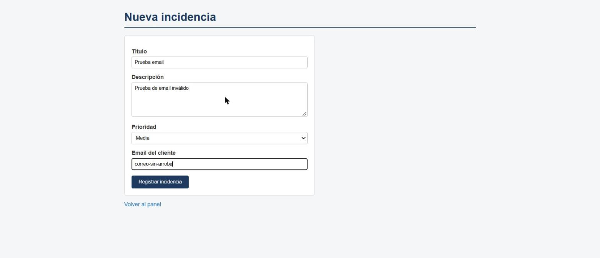
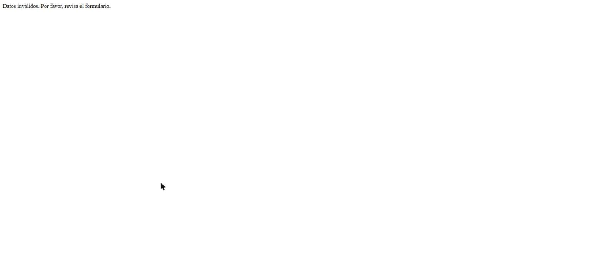
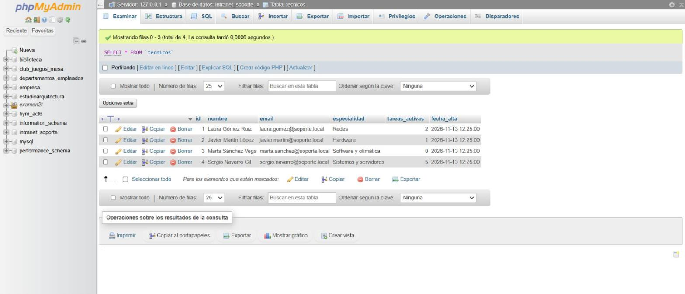
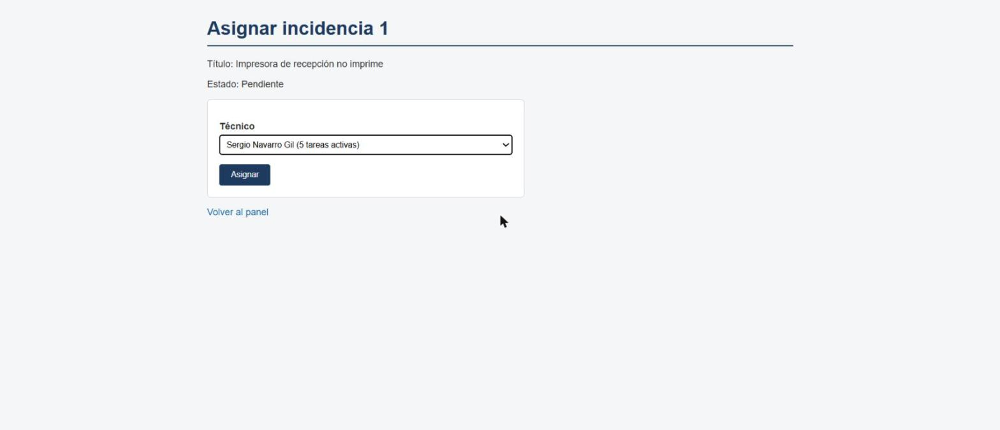
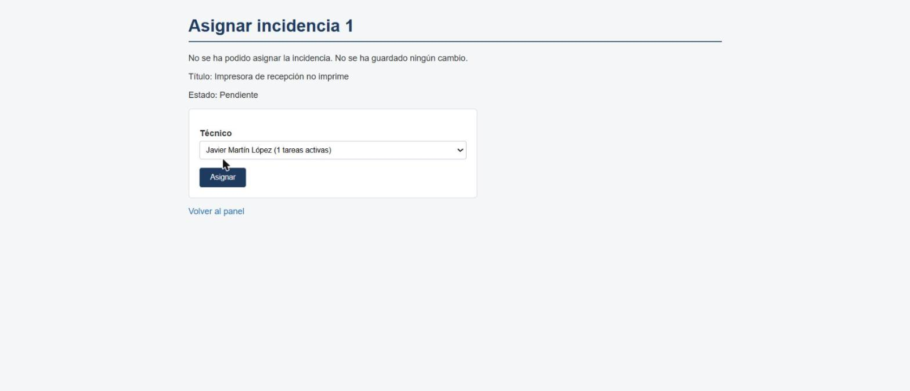
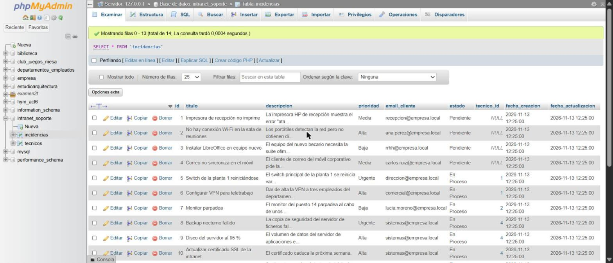
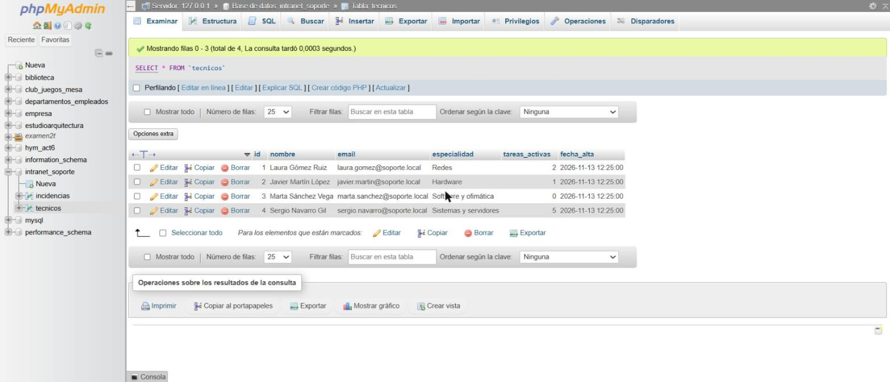

# Casos de prueba ejecutados

Pruebas realizadas el 13/11/2026 en local con XAMPP, sobre la base de datos recién importada desde `schema.sql`.

## Resumen

| N.º | Caso | Entrada | Resultado esperado | Resultado obtenido | Estado |
|---|---|---|---|---|---|
| 1 | Email inválido en el formulario de alta | Email `correo-sin-arroba` en `nueva_incidencia.php` | El filtro rechaza el dato y no se inserta nada | Mensaje "Datos inválidos. Por favor, revisa el formulario." y ninguna fila nueva | Superado |
| 2 | Editar una incidencia con un ID que no existe | URL `editar_incidencia.php?id=9999` | Error controlado, sin mostrar el formulario ni errores de PHP | Mensaje "La incidencia no existe." | Superado |
| 3 | Falla la segunda parte de la transacción | Asignar la incidencia 1 a Sergio Navarro Gil, que ya tiene 5 tareas activas (el máximo) | `rollBack()` completo: la incidencia no cambia y el contador del técnico tampoco | Mensaje de error; la incidencia 1 sigue `Pendiente` sin técnico y Sergio sigue con 5 tareas | Superado |

## Caso 1. Email inválido en el formulario

**Qué se prueba:** que `filter_input()` con `FILTER_VALIDATE_EMAIL` rechaza un correo mal formado antes de llegar a la base de datos.

**Pasos:**

1. Abrir `http://localhost/Taskshield/nueva_incidencia.php`.
2. Rellenar título, descripción y prioridad, y escribir `correo-sin-arroba` como email.
3. Pulsar **Registrar incidencia**.

**Resultado:** `FILTER_VALIDATE_EMAIL` devuelve `false`, el script se detiene con un mensaje y no se ejecuta el `INSERT`.

## Caso 2. Editar una incidencia con un ID que no existe

**Qué se prueba:** que `editar_incidencia.php` comprueba que el registro existe antes de mostrar el formulario.

**Pasos:**

1. Abrir `http://localhost/Taskshield/editar_incidencia.php?id=9999` (no hay ninguna incidencia con ese ID).

**Resultado:** el `SELECT` no devuelve ninguna fila (`fetch()` devuelve `false`) y se muestra un mensaje controlado, sin formulario ni errores de PHP.

Si el ID no es un número (por ejemplo `?id=abc`), `FILTER_VALIDATE_INT` lo rechaza antes de consultar y se muestra "ID de incidencia no válido."

## Caso 3. Falla la segunda parte de la transacción

**Qué se prueba:** que si falla el segundo `UPDATE` de la asignación, el primero no queda guardado.

La asignación ejecuta dos consultas dentro de una transacción:

1. `UPDATE incidencias`: pasa la incidencia a `En Proceso` y le asigna el técnico.
2. `UPDATE tecnicos`: suma 1 a `tareas_activas` del técnico.

Para provocar el fallo de la segunda se usa a Sergio Navarro Gil (ID 4), que ya tiene 5 tareas activas. La tabla `tecnicos` tiene la restricción `CHECK (tareas_activas <= 5)`, así que la primera consulta se ejecuta bien y la segunda lanza una excepción.

**Estado inicial:** Sergio Navarro Gil tiene 5 tareas activas.

**Pasos:**

1. Abrir `http://localhost/Taskshield/asignar_incidencia.php?id=1` (incidencia "Impresora de recepción no imprime", en estado `Pendiente`).
2. Elegir a **Sergio Navarro Gil (5 tareas activas)**.
3. Pulsar **Asignar**.

**Resultado:** la excepción se captura, se ejecuta `rollBack()` y se muestra un mensaje genérico.

**Verificación en la base de datos:** la incidencia 1 sigue en estado `Pendiente` y con `tecnico_id` a `NULL`, es decir, el primer `UPDATE` no se guardó.

Sergio Navarro Gil sigue con 5 tareas activas.

